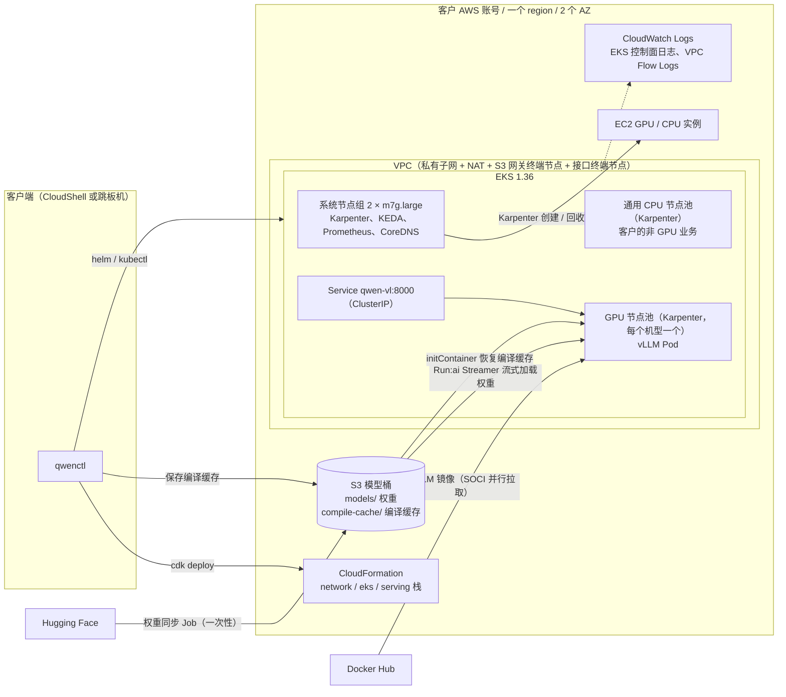
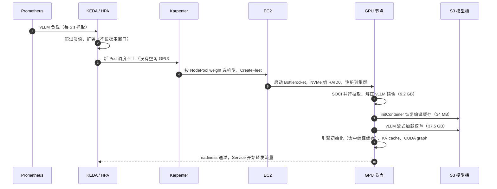
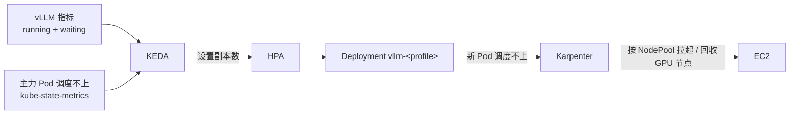

# 架构与使用手册（当前实现）

> 版本：v1.0 | 日期：2026-11-04 | 对应代码：`main` 分支
> 本文描述**已经实现并在 ap-southeast-5 验证过**的架构和用法。设计目标和取舍见 [01 方案设计](01-architecture-design.md)，测试数据见 [05 测试报告](05-test-report.md)。
> 文中命令默认部署名为 `qwen-vl`，region 用 CloudShell 当前的 region。执行前先设置：
> ```bash
> export KUBECONFIG=~/.qwenctl/qwen-vl/kubeconfig          # 部署完成时 qwenctl 会提示
> alias kubectl=~/.qwenctl/bin/kubectl-v1.36.6              # 可选：用和部署时相同版本的 kubectl
> ```

---

## 0. 当前能力一览

| 能力 | 状态 | 说明 |
|---|---|---|
| CloudShell 交互式部署（4 个问题），断线续跑，用保存的配置更新 | ✅ | `./qwenctl deploy`、`--resume`、`--update`（§5.1） |
| 网络、EKS、Karpenter、通用 CPU 节点池、GPU 节点池 | ✅ | CloudFormation 3 个栈 + 客户端 helm / kubectl（§1） |
| 模型权重同步到客户自己的 S3，逐文件校验哈希 | ✅ | 一次性，之后自动跳过 |
| vLLM 推理服务（每个 GPU 机型一个 Deployment） | ✅ | OpenAI 兼容 API，**目前只能在集群内访问，没有认证**（§5.2） |
| 按负载自动扩缩容 + 主力机型没货时自动回退 | ✅ | KEDA + Karpenter（§4） |
| 冷启动优化（NVMe、SOCI 并行拉取、S3 流式加载权重、S3 编译缓存） | ✅ | 新节点扩容约 3 分 40 秒（§3） |
| 客户的非 GPU 业务共用集群 | ✅ | 不加任何设置就落到通用 CPU 节点池（§4.7） |
| 网关（internal ALB + API Key）、NetworkPolicy | ⏳ 计划中 | **交付生产前必须完成** |
| 可观测性：CloudWatch 面板、告警、容器日志集中采集 | ⏳ 计划中 | 现在能用的手段见 §6 |
| `status`、`test`、`scale`、`destroy` 等运维命令 | ⏳ 计划中 | 临时做法见 §5 |
| 部署时提问的「访问方式」和「可选能力（异步通道 / Bedrock 溢出 / 告警邮箱）」 | ⏳ 已保存，基本不生效 | 网关和可观测性阶段接入。目前只有「异步通道」会影响是否创建 sqs 接口终端节点 |

---

## 1. 总体架构



### 1.1 资源清单

| 位置 | 内容 |
|---|---|
| CloudFormation `qwen-vl-network` | VPC（新建时）、2 个 AZ 的公有 / 私有子网、NAT、S3 网关终端节点、ecr.api / ecr.dkr / sts / eks-auth / sqs 接口终端节点、VPC Flow Logs |
| CloudFormation `qwen-vl-eks` | EKS 集群（控制面日志开启 api / audit / authenticator / scheduler；API 端点默认公网 + 私网，见 §7）、系统节点组（Bottlerocket、IMDSv2、EBS 加密）、5 个 add-on（vpc-cni、kube-proxy、coredns、eks-pod-identity-agent、eks-node-monitoring-agent）、Karpenter 的 IAM 角色和 Pod Identity、中断事件 SQS 队列 + EventBridge 规则、管理员 access entry |
| CloudFormation `qwen-vl-serving` | S3 模型桶（禁止公开访问、强制 TLS、加密、版本控制，**删栈时保留**）；vLLM 和权重同步 Job 的 Pod Identity 角色 |
| Helm（kube-system） | Karpenter 1.15.1 |
| Helm（monitoring） | kube-prometheus-stack 92.17.1 精简版：Prometheus（保留 6 小时）、kube-state-metrics、operator |
| Helm（keda） | KEDA 2.21.0 |
| K8s（集群级） | EC2NodeClass `general`、`gpu`；NodePool `general`、`gpu-<profile>` |
| K8s（命名空间 `qwen-vl`） | Deployment `vllm-<profile>`、Service `qwen-vl`、ScaledObject `vllm-<profile>`、PodMonitor `vllm`、权重同步 Job、编译缓存恢复脚本 ConfigMap |
| 客户端 `~/.qwenctl/qwen-vl/` | 部署配置 `config.json`、进度 `state.json`、kubeconfig、Helm values（只有本人可读写）。**这是更新和续跑用的唯一一份配置，请备份**（§5.1） |

所有版本都锁定在仓库根目录的 `versions.json`：工具和 chart 带 sha256，vLLM 镜像按 digest，模型按 revision。

### 1.2 节点分层

| 节点 | 管理方式 | 机型 | 污点 | 运行什么 |
|---|---|---|---|---|
| 系统节点 | EKS 托管节点组，固定 2 台（每个 AZ 1 台） | m7g.large（Graviton） | `CriticalAddonsOnly` | Karpenter、KEDA、Prometheus、CoreDNS 等插件 |
| 通用 CPU 节点 | Karpenter NodePool `general` | c / m / r 系列第 6 代及以上，x86，按需实例，vCPU 合计上限 200 | 无 | **客户的非 GPU 业务**、权重同步 Job |
| GPU 节点 | Karpenter NodePool `gpu-<profile>`，每个 GPU profile 一个 | 见 §4.2 | `nvidia.com/gpu` | 只有 vLLM |

### 1.3 推理服务

- 每个 GPU profile 一个 Deployment（`vllm-g7e-1gpu`、`vllm-g6-tp2`），所有 profile 共用一个 Service `qwen-vl.qwen-vl.svc:8000`，所以回退副本扩出来后会直接分担流量。
- **共用 Service 的代价**：一个请求会随机落到任意一个 profile 的副本上，所以**客户端要按所有 profile 中最小的上限来发请求**。按下表，当前是 8K 上下文、每请求 2 张图。超出回退机型上限的请求，落到回退副本上会返回 400。
- vLLM 从 S3 流式加载权重（`--load-format=runai_streamer`），启动过程不访问 Hugging Face（`HF_HUB_OFFLINE=1`）。
- 每个 profile 有自己的参数上限：

  | profile | 上下文 | 最大并发序列 | 每请求图片数 |
  |---|---|---|---|
  | g7e-1gpu | 32K | 128 | 4 |
  | g6-tp2 | 8K | 16 | 2 |

  g6-tp2 的上限更小，是因为 L4 显存小。
- 优雅下线：先 `preStop` 等 15 s，让流量摘掉，再用剩下的最多 165 s 处理完正在进行的请求（合计 `terminationGracePeriodSeconds: 180`）。
- 滚动更新时不会多开副本（`maxSurge: 0`），因为多开一个副本就要多一台 GPU 节点。代价是：更新期间每次先停一个副本，minReplicas = 1 时服务会中断，minReplicas = 2 时容量减半。

---

## 2. 请求路径

| 阶段 | 路径 |
|---|---|
| 当前 | 集群内的客户端 → Service `qwen-vl:8000` → 任意一个就绪的 vLLM Pod（kube-proxy 随机分发，不感知各副本的负载） |
| 计划（网关阶段） | 客户端 → internal ALB（或公网 HTTPS） → 网关（API Key 鉴权、限流、请求大小和图片像素校验） → vLLM；NetworkPolicy 只放行网关 |

> 在网关上线之前，**不要**把 Service 改成 LoadBalancer 或者通过 Ingress 暴露出去：vLLM 本身没有认证。

---

## 3. 冷启动全流程

「冷启动」指从需要一个新副本开始，到这个副本能接流量为止。最慢的情况是「新节点」：GPU 节点要现拉，镜像也要现拉。

### 3.1 一次扩容的完整链路（新节点，实测 3 分 38 秒）



| # | 阶段 | 由谁完成 | 怎么优化的 | 实测（优化前 → 优化后） |
|---|---|---|---|---|
| 1 | 扩容决策 | KEDA 查询集群内 Prometheus | vLLM 指标每 5 s 抓取一次；扩容不设稳定窗口 | 秒级（按负载扩容尚未压测；回退判定见 §4.4） |
| 2 | 调度、建节点 | Karpenter 直接调 EC2 Fleet，不经过 ASG | 多个 GPU 机型按 weight 依次尝试 | 42 s → 37 s（从副本数变化到节点就绪） |
| 3 | 拉镜像 | Bottlerocket 的 SOCI snapshotter | 镜像层落到本地 NVMe（RAID0）；20 路并行下载、16 MB 分块、4 路解压 | 89 s → **52 s** |
| 4 | 恢复编译缓存 + 启动容器 | initContainer（用的就是 vLLM 镜像，不多拉镜像） | torch.compile / Triton 产物从 S3 下载，只读 | — → 9 s（恢复 3 s + 启动容器 6 s） |
| 5 | 进程启动 + 权重 | vLLM + Run:ai Model Streamer | 权重放在同 region 的 S3，经网关终端节点读取，16 路并发 | 93 s → 84 s（其中权重 37 s） |
| 6 | 引擎初始化 + 接流量 | vLLM；readiness probe（每 5 s）→ Service | 命中编译缓存：torch.compile 31 s → 0.5 s，首次 profiling（kernel JIT）60 s → 0.7 s | 139 s → **36 s**（引擎初始化 25 s + API 启动和 readiness 11 s） |
| | **合计** | | | **6 分 02 秒 → 3 分 38 秒** |

各段按 Kubernetes 和 vLLM 记录的时间戳计算，精度 1 秒。

**保温节点**：缩容后，空闲的 GPU 节点会保留 10 分钟（§4.5）。这段时间里再扩容，第 2、3 步为 0，约 2 分钟就能接流量。这是按「同一个 Pod 内重启容器、编译缓存还在」实测 2 分 07 秒估算的。

### 3.2 编译缓存的生命周期

1. **首次部署**：第一个副本从头编译（多 90 s 左右）。`serving` 阶段等到它就绪后，qwenctl 用部署者自己的凭证，把它的缓存打包上传到 `s3://<模型桶>/compile-cache/<profile>/<key>/`。
2. **之后每个新副本**：initContainer 先把缓存恢复到本地，vLLM 直接加载。
3. **key** 由镜像 digest、模型 revision、profile 和 vLLM 参数一起计算。升级 vLLM、换模型、改参数（例如 `max_model_len`）都会得到新的 key。新 key 的第一个副本会重新编译，下次 `--update` 时再保存。
4. **回退机型的缓存**：只有部署时回退机型恰好有就绪副本，才会保存它的缓存。否则回退副本第一次扩出时会冷编译（多约 90 s），等下次 `--update` 时再补上。
5. **安全**：缓存里有生成的代码。vLLM 对它**只读**；上传前检查压缩包（只能是普通文件和目录，不能指向目录外，数量和大小都有上限），并且只在不存在时才写入（条件写）；恢复时用同样的规则。任何一步失败都会退回冷编译，不会挡住启动。要清掉缓存，删除 `compile-cache/<profile>/` 下的对象即可。

### 3.3 还能怎么继续压缩

离新节点 3 分钟的目标还差约 40 s：
- 进程启动约 47 s，其中多模态预处理预热 16 s；
- 拉镜像 52 s：可以改从区域内的 ECR 拉，或者预缓存到 EBS 快照；
- 权重 37 s：g7e 的网络是 50 Gbps，预计会更快。

见 [05 §6.3](05-test-report.md#63-离目标还差多少)。

---

## 4. 弹性伸缩：KEDA + Karpenter

### 4.1 两层伸缩



- **Pod 层（KEDA → HPA）**：决定每个 profile 要几个副本。KEDA 只看 vLLM 自己的负载指标，不看 GPU 利用率：低负载时 GPU 利用率也可能很高，反映不出真实的饱和度。
- **节点层（Karpenter）**：Pod 调度不上时，按 NodePool 的机型、AZ、上限拉起节点；节点空了以后回收。Karpenter 直接调 EC2，不经过 Auto Scaling Group。
- 两层都由 qwenctl 生成配置，客户不需要手写 YAML。

### 4.2 GPU profile 和 NodePool

| profile | 机型 | 每副本 GPU | 每节点副本 | NodePool weight | 可用 AZ（马来西亚） | 容量类型 |
|---|---|---|---|---|---|---|
| g7e-1gpu（主力） | g7e.2xlarge / g7e.4xlarge | 1 | 1 | 100 | apse5-az2 | 按需 |
| g6-tp2（回退） | g6.12xlarge（4×L4） | 2（TP=2） | 2 | 10 | apse5-az1、apse5-az2 | 按需 |

> **容量预留（ODCR）**：NodePool 的容量类型里允许了 `reserved`，但 EC2NodeClass 还没有配置容量预留选择器（`capacityReservationSelectorTerms`），**所以 Karpenter 目前不会主动指定或优先使用 ODCR**。open 类型的 ODCR 能不能被 EC2 自动套用，没有验证。购买 ODCR 之前请先确认这项支持已经上线（计划中）。

- GPU 节点的容器镜像和 Pod 临时存储（emptyDir）都在本地 NVMe 实例存储上，由 Nitro 硬件加密，**不受客户 CMK 约束**；EBS 数据盘仍按配置加密。有「落盘数据都要用 CMK」合规要求的客户，需要评估这一点。
- profile 在部署时按当前 region 的供货情况自动选择，锁定在 `cli/qwenctl/catalog.py`。别的 region 可能还有 g6e-1gpu（L40S）。
- **GPU 上限**：每个 NodePool 的 `limits.nvidia.com/gpu` = 跑满 maxReplicas 需要的 GPU 数。例如 maxReplicas = 8 时，g7e 上限是 8 卡，g6-tp2 上限是 16 卡（4 台节点）。指标异常时副本数也不会超过 maxReplicas。Karpenter 的上限是最终一致的，同时拉起多台节点时可能短暂多出一台。
- 回收策略：`consolidationPolicy: WhenEmpty`，**只回收空节点，不会为了装箱驱逐正在推理的 Pod**。
- **节点到期**：节点最长存活 30 天（`expireAfter: 720h`），到期后 Karpenter 强制替换，以便更新 AMI。同一批拉起的节点会差不多同时到期，副本可能一起被重建，新节点上要重新冷启动，也可能遇到 ICE。目前没有为 vLLM 配置 PodDisruptionBudget，生产环境建议在低峰期主动滚动替换（计划中）。

### 4.3 主力机型：按负载扩缩容

| 触发器 | 指标 | 每副本阈值（默认） |
|---|---|---|
| 负载 | `vllm:num_requests_running + vllm:num_requests_waiting`（所有副本求和） | `target_utilization × C_sla` = 0.65 × 32 ≈ **21** |
| 排队 | 过去 1 分钟里 `vllm:num_requests_waiting`（所有副本求和）的最大值 | **4** |

- 阈值都是「每副本平均值」：目标副本数 = ⌈指标 ÷ 阈值⌉。两个触发器取较大者，范围在 `minReplicas` 和 `maxReplicas` 之间。例如负载为 50 时要 3 个副本；1 分钟内最多排队 9 个时，排队触发器要 3 个副本。
- **扩得快**：不设稳定窗口，每 30 s 最多扩 100% 或 +4 个，取两者较大者。
- **缩得慢**：稳定窗口 15 分钟，之后每 5 分钟最多缩 1 个副本，因为每次冷启动都很贵。
- **指标查不到时**（Prometheus 故障）：连续失败 3 次后启用 fallback，保持当前副本数，不会缩到最小值（`fallback: currentReplicasIfHigher`）。测试中 Prometheus 刚启动时触发过，KEDA 日志里有 `Suppressing error, using fallback metrics`。
- `C_sla` 是单副本在 SLA 内能承受的并发数。现在用的是**占位值**（g7e 32、g6-tp2 8），要压测后写入 `advanced.scaling.c_sla`（§4.8）。

### 4.4 主力机型没货时：自动回退（接力）

马来西亚的 g7e 只在一个 AZ 有，经常出现容量不足（ICE）。回退由两层共同完成：

1. **Pod 层**：回退 profile 的 ScaledObject 平时副本数是 0。它的触发器是「主力 profile 里创建超过 180 s 还**调度不上**的 Pod 数」，按 1:1 扩出回退副本。
   - 判断的是「调度不上」，不是「Pending」：镜像拉取期间 Pod 也处于 Pending，正常扩容不应该触发回退。有容量时，Karpenter 约 40 s 就能让 Pod 调度上，远小于 180 s。
2. **节点层**：回退副本有自己的 NodePool（g6.12xlarge，两个 AZ），Karpenter 直接拉起。
3. **主力恢复后**：调度不上的 Pod 数归零，回退副本再保留 10 分钟（`cooldownPeriod: 600`，让主力新副本有时间完成冷启动）才缩回 0，节点空闲 10 分钟后被回收。
4. **3 个以上 profile 时按顺序接力**：第二个看主力，第三个看第二个。只有上一级也没货才会轮到下一级，不会同时扩出好几种机型。

实测：回退副本数被设为 1 之后，新节点上的副本约 3 分 40 秒 Ready（优化后，[05 §6.1](05-test-report.md#61-新节点冷启动扩容触发--新节点上的副本-ready)）。加上 180 s 的判定时间和约 30 s 的指标延迟，主力没货时**约 7 分钟**后有回退副本在服务（[05 §5.2](05-test-report.md#52-keda-自动扩出回退副本)）。

**回退期间的负载**：按负载扩容的触发器只挂在主力 profile 上，阈值用的是主力的 `C_sla`。回退副本数只跟着「调度不上的主力 Pod 数」走，所以回退期间：
- 每个回退副本实际承担的并发可能超过它的能力（g6-tp2 在 8K 上下文下约 9 路），多出的请求会在 vLLM 里排队；
- 排队会让主力的目标副本数继续上升，这些新的主力 Pod 同样调度不上，于是又按 1:1 扩出回退副本。所以容量最终会跟上，但会慢一拍。

> **成本上限**：主力和回退各自最多 maxReplicas 个副本，同时打满时成本是两者之和。

### 4.5 缩容和保温

| 层 | 行为 | 时间 |
|---|---|---|
| 主力副本 | 15 分钟稳定窗口，之后每 5 分钟缩 1 个，不低于 minReplicas | 慢 |
| 回退副本 | 主力恢复后保留 10 分钟，再缩到 0 | 10 分钟 |
| GPU 节点 | 节点空了以后保留 `warm_node_minutes`（默认 10 分钟），这段时间内再扩容约 2 分钟就能服务（保温） | 10 分钟 |
| 节点终止 | EC2 进入 `shutting-down` 后就停止计费。g6.12xlarge 要 7~8 分钟才完全终止，期间 NodeClaim 还会显示 | — |

### 4.6 配额和副本数上限

- 部署时会按当前 G/VT 配额计算副本数上限，客户选的 maxReplicas 不会超过它。**但这个上限是按主力机型算的**：主力 g7e.2xlarge 每副本 8 vCPU，回退 g6-tp2 每副本 24 vCPU（g6.12xlarge 48 vCPU，跑 2 个副本）。回退打满 maxReplicas 时，需要的 G/VT 配额是主力的 3 倍。按「maxReplicas × 24 vCPU」准备配额，回退时才不会被配额卡住。
- **配额和其他业务共享**：账号里其他 G/VT 实例占用的配额，在扩容时同样会让 Karpenter 拿不到实例。Karpenter 会报 `InsufficientCapacity` 或配额错误，排查方法见 §6.3。

### 4.7 通用 CPU 节点池（客户的非 GPU 业务）

- **用法**：像在普通集群里一样 `kubectl apply`，不需要 nodeSelector 或 toleration。Karpenter 按 Pod 的 requests 拉起合适的 c / m / r 实例：实测 37 s 就绪，删除业务后约 2 分钟回收节点。
- **建议**：
  - 一定要写 `resources.requests`：Karpenter 按 requests 选机型和装箱。
  - 这个节点池会把负载低的节点上的 Pod 挪走、合并节点（`WhenEmptyOrUnderutilized`，空闲 1 分钟后开始）。对中断敏感的业务，请配置 PodDisruptionBudget，或者给 Pod 加上 annotation `karpenter.sh/do-not-disrupt: "true"`。
  - 默认只用 x86 按需实例。确认业务镜像支持 arm64 后，可以在高级配置 `general_nodes.arch` 里加上 `arm64`（Graviton 更便宜）。能容忍中断的业务，可以在 `general_nodes.capacity_types` 里加上 `spot`。
  - vCPU 合计上限 200（`general_nodes.cpu_limit`），用来防止成本失控。
- 业务 Pod 不会落到 GPU 节点（`nvidia.com/gpu` 污点）和系统节点（`CriticalAddonsOnly` 污点）上。

### 4.8 可以调的参数

改 `~/.qwenctl/qwen-vl/config.json` 里对应的字段，再运行 `./qwenctl deploy --update`（§5.4）。

| 参数 | 位置 | 默认 | 作用 |
|---|---|---|---|
| 副本范围 | `gpu.minReplicas` / `gpu.maxReplicas` | 部署时回答 | 主力的常驻副本数和上限；回退的上限也是 maxReplicas；NodePool 的 GPU 上限随之变化 |
| 目标利用率 | `advanced.scaling.target_utilization` | 0.65 | 越小越早扩容：buffer 越大，冷启动越不容易打破 SLA，成本越高 |
| 单副本 SLA 并发 | `advanced.scaling.c_sla.<profile>` | 占位值 | **压测后必填**，例如 `{"g7e-1gpu": 40}`。目前只有主力 profile 的值会用来算阈值（§4.4） |
| 排队阈值 | `advanced.scaling.waiting_threshold` | 4 | 每副本平均排队数：目标副本数 = ⌈1 分钟内最大排队数 ÷ 阈值⌉ |
| 保温时长 | `advanced.scaling.warm_node_minutes` | 10 | 空闲 GPU 节点保留多久 |
| 推理参数 | `advanced.serving.max_model_len` / `max_num_seqs` / `max_images_per_request` / `gpu_memory_utilization` | 32768 / 128 / 4 / 0.92 | 前三项和 profile 的上限取较小者。改了会滚动重启 vLLM（§1.3 的中断说明），编译缓存的 key 也会变 |

> 高级配置里其他的项，**当前版本还没有接入，填了也不生效**：`kv_cache_threshold`、`schedule`、`max_image_pixels`、`capacity.extra_fallback_types`、`observability.amp`、`image.*`。另外，`observability.log_retention_days` 里只有 `access` 生效（EKS 控制面日志和 VPC Flow Logs 的保留期）。见 [03 §3.3](03-deployment-parameters.md#33-高级配置configyaml全部可选不写就用默认值)。

---

## 5. 使用手册

### 5.1 部署、续跑、更新

**准备交付包**：交付包里要有预先编译好的 CDK（`infra/dist/`）。这个目录不在 git 里，直接 `git clone` 下来部署会在第一个阶段报错「缺少编译好的 infra/dist」。在一台装了 Node.js 和 GNU tar 的开发机上打包（先提交所有改动：`git archive` 打包的是已提交的内容，`infra/dist` 却是从工作区编译的，两者要一致）：

```bash
cd gpu-on-eks/infra && npm ci && npm run build && cd ..
git archive --format=tar --prefix=gpu-on-eks/ HEAD > ../gpu-on-eks.tar         # 只打包 git 里的文件
tar rf ../gpu-on-eks.tar --transform 's,^,gpu-on-eks/,' infra/dist              # 再加上编译好的 CDK
gzip ../gpu-on-eks.tar                                                          # 得到 gpu-on-eks.tar.gz（约 240 KB）
```

不要直接 `tar` 整个工作目录：`infra/cdk.out/`、`cdk.context.json` 里有执行 synth 的账号信息，还会带上测试覆盖率和缓存文件。

然后在 CloudShell 里用 **Actions → Upload file** 上传 `gpu-on-eks.tar.gz`，再 `tar xzf gpu-on-eks.tar.gz`。

```bash
cd gpu-on-eks
./qwenctl preflight                  # 只做环境检查（只读）
./qwenctl deploy                     # 环境检查 + 4 个问题 + 确认 → 部署（首次约 30~40 分钟，含权重同步）
./qwenctl deploy --resume            # 断线或失败后，从中断的阶段继续，不再提问
./qwenctl deploy --update            # 用保存的配置重新执行所有阶段（升级交付包、改参数后使用）
export KUBECONFIG=~/.qwenctl/qwen-vl/kubeconfig
```

- CloudShell 空闲 20~30 分钟会断开，但 CloudFormation 会在服务端继续执行。重新打开后运行 `--resume` 即可。
- ⚠️ **已经部署过的，只用 `--resume` 或 `--update`**。不带这两个参数再次运行 `deploy`（包括 `--yes`），会重新提问或者全部取默认值，然后**覆盖** `config.json`；如果还加了 `--approve`，会按新的回答重新部署，例如把现有 VPC 换成新建 VPC、把副本数改回默认值。当前版本还不能识别「已有同名部署」，这是已知问题（§7）。
- **备份 `~/.qwenctl/qwen-vl/config.json`**：这是更新和续跑用的唯一一份配置。CloudShell 的 home 目录虽然会保留，但只有 1 GB、只属于当前用户，而且 **120 天没有使用 CloudShell 就会被清除**。
- **换一个人或换一台机器操作**：
  1. 把交付包和 `config.json` 复制到对方的同一路径下。
  2. 集群只给部署者的 IAM 角色和 `advanced.compliance.extra_admin_role_arns` 里的角色授了访问权限。所以对方如果用的是另一个 IAM 角色，先把自己的角色 ARN 加进 `config.json` 的 `advanced.compliance.extra_admin_role_arns`，再运行 `./qwenctl deploy --update`。第 3 阶段（CloudFormation）会先给这个角色建好集群访问权限，之后的阶段就能用了。这一步还没有实测。

### 5.2 调用推理服务

服务是 OpenAI 兼容 API，模型名是 `qwen-vl`。**目前只能在集群内访问，没有认证。**

```bash
# 集群内的地址
http://qwen-vl.qwen-vl.svc:8000/v1/chat/completions

# 从 CloudShell 临时测试（转发到本机端口；只用于测试，测出来的延迟不准）
kubectl -n qwen-vl port-forward svc/qwen-vl 8000:8000 &
curl -s localhost:8000/v1/chat/completions -H 'Content-Type: application/json' -d '{
  "model": "qwen-vl",
  "messages": [{"role": "user", "content": [
    {"type": "image_url", "image_url": {"url": "data:image/png;base64,<BASE64>"}},
    {"type": "text", "text": "识别这张设备铭牌，只输出 JSON"}]}],
  "max_tokens": 512, "temperature": 0,
  "chat_template_kwargs": {"enable_thinking": false}
}'
```

- **记得关闭 thinking**：每个请求都带上 `"chat_template_kwargs": {"enable_thinking": false}`。服务端没有默认关闭，不带的话模型会先输出一段推理过程，变慢、变长。
- 图片用 base64 内嵌。请按所有 profile 中最小的上限发请求（当前是 8K 上下文、每请求 2 张图，见 §1.3），否则落到回退副本上会返回 400。图片像素目前没有在服务端限制，请在客户端把单图控制在 2 MP 以内。
- 不要在请求里用 `http(s)://` 图片 URL：vLLM 会去拉取这个地址，服务端目前没有限制可拉取的域名（§7）。
- 验收测试：[`e2e/infer_test.py`](../e2e/infer_test.py) 在 vLLM 容器里直接请求本地端口，测纯文本、图片 → JSON、8 路并发：

  ```bash
  # 选一个已就绪的副本（加载模型期间 Pod 也是 Running，但还不能接请求）
  POD=$(kubectl -n qwen-vl get pod -l app=qwen-vl -o jsonpath='{range .items[?(@.status.containerStatuses[0].ready==true)]}{.metadata.name}{"\n"}{end}' | head -1)
  kubectl -n qwen-vl exec -i "$POD" -c vllm -- python3 - < e2e/infer_test.py   # 最后一行输出「结果：通过」，退出码 0
  ```

  脚本会在这个副本上并发 8 路请求，有真实流量时会和业务争用 GPU，请在低峰期运行。

### 5.3 部署客户自己的业务

```bash
kubectl create namespace my-app
kubectl -n my-app create deployment web --image=public.ecr.aws/nginx/nginx:stable --replicas=2
kubectl -n my-app set resources deployment web --requests=cpu=500m,memory=512Mi
kubectl get nodeclaims -w        # 可以看到 Karpenter 拉起通用节点
```

### 5.4 调整副本范围、扩缩容参数（`scale` 命令上线前的临时做法）

1. 编辑 `~/.qwenctl/qwen-vl/config.json`：`gpu.minReplicas` / `gpu.maxReplicas`，或者 `advanced.scaling.*`（§4.8）。
2. 运行 `./qwenctl deploy --update`。qwenctl 会重新校验配置，然后更新 NodePool 的 GPU 上限和 ScaledObject，正在服务的副本不会重启。
3. 注意：这样改**不会重新检查 G/VT 配额**。调大 maxReplicas 之前，请先在 Service Quotas 里确认配额够用。

### 5.5 暂停 / 恢复 GPU（不用的时候省钱）

副本数由 KEDA 管理，直接 `kubectl scale` 到 0 会被 KEDA 改回来。要暂停，就让 KEDA 停在 0：

```bash
# 暂停：所有 GPU 副本停到 0，GPU 节点空闲 10 分钟后被回收
kubectl -n qwen-vl annotate scaledobject --all autoscaling.keda.sh/paused-replicas=0 --overwrite

# 恢复：去掉注解，KEDA 恢复按 minReplicas 和负载扩缩容（主力有货时冷启动约 4 分钟）
kubectl -n qwen-vl annotate scaledobject --all autoscaling.keda.sh/paused-replicas-

# 确认 GPU 节点都已回收
kubectl get nodeclaims
```

暂停期间，`./qwenctl deploy --update` 的最后一个阶段会一直等不到就绪的副本，最多等 25 分钟后给出提示（不算失败）。所以暂停时尽量不要做更新。

### 5.6 清理环境（`destroy` 命令上线前的临时做法）

Karpenter 拉起的实例、它为节点创建的 instance profile，都不在 CloudFormation 的管理范围里，**必须先在集群里清掉，再删栈**：
- 不先回收节点：实例会继续计费，VPC 也会因为还有网卡而删不掉；
- 不先删 EC2NodeClass：它的 instance profile 还挂着节点角色，删 EKS 栈时删不掉这个角色。

> 这套步骤还没有在测试环境完整执行过（`destroy` 命令会把它自动化）。请按顺序执行，每一步确认完成再做下一步。

```bash
# 准备：明确指定集群和 region，避免 kubectl 落到 CloudShell 里配置的其他集群
NAME=qwen-vl
export KUBECONFIG=~/.qwenctl/$NAME/kubeconfig
REGION=$(python3 -c "import json,os;print(json.load(open(os.path.expanduser('~/.qwenctl/$NAME/config.json')))['region'])")
kubectl config current-context        # 确认输出里是 cluster/$NAME，不是就停下
kubectl get nodepools                  # 确认是要删除的节点池

# 0. 先删除客户自己的业务（含 PodDisruptionBudget、LoadBalancer 类型的 Service、Ingress）。
#    PDB 和 do-not-disrupt 会挡住节点回收；负载均衡器不先删，VPC 删不掉。确认下面没有输出：
kubectl get svc -A | grep LoadBalancer; kubectl get ingress -A

# 1. 停掉所有 GPU 副本，删除 NodePool（Karpenter 会终止它创建的所有节点）
kubectl -n qwen-vl annotate scaledobject --all autoscaling.keda.sh/paused-replicas=0 --overwrite
kubectl delete nodepools --all

# 2. 等到没有任何 NodeClaim（GPU 节点终止要 7~8 分钟）。超时了就停下排查，不要往下做
kubectl wait --for=delete nodeclaims --all --timeout=30m

# 3. 删除 EC2NodeClass，Karpenter 会删掉它创建的 instance profile
kubectl delete ec2nodeclasses --all

# 4. 硬检查：不能还有 Karpenter 拉起的实例。有输出就停下，否则删掉集群后就没人能回收它们了
aws ec2 describe-instances --region $REGION \
  --filters "Name=tag:eks:eks-cluster-name,Values=$NAME" "Name=tag-key,Values=karpenter.sh/nodepool" \
            "Name=instance-state-name,Values=pending,running,stopping,stopped" \
  --query 'Reservations[].Instances[].InstanceId' --output text

# 5. 按顺序删栈，任何一步失败就停下；最后复查
for s in $NAME-serving $NAME-eks $NAME-network; do
  aws cloudformation delete-stack --region $REGION --stack-name $s &&
  aws cloudformation wait stack-delete-complete --region $REGION --stack-name $s ||
  { echo "删除 $s 没有成功，先处理再继续"; break; }
done
aws cloudformation describe-stacks --region $REGION \
  --query "Stacks[?starts_with(StackName, '$NAME-')].[StackName,StackStatus]" --output table
```

删栈之后，还有几样东西会保留，要手动处理：
- **模型桶**（37.5 GB 权重，误删要重新下载）。确认不再需要后，到 S3 控制台清空桶（包括所有对象版本）再删除。
- **VPC Flow Logs 的日志组**（`<name>-network-VpcFlowLogs...`）：删栈时保留，确认不需要后到 CloudWatch Logs 删除。
- `CDKToolkit` 栈是账号级的 CDK bootstrap，其他 CDK 项目可能也在用，不要随手删除。
- 最后删除本地的 `~/.qwenctl/qwen-vl/`。

### 5.7 升级交付包的注意事项

新版本的交付包通过 `./qwenctl deploy --update` 升级：
- **GPU profile 的参数不会自动更新**：保存的配置里已有的 profile 参数（`cSla`、`servingLimits`、`podCpu` / `podMemory` 等）会原样保留，新版机型目录里的新值只用来补齐缺失的字段。要用新值，请对照新版的 `cli/qwenctl/catalog.py` 手动修改 `config.json`。
- **Bottlerocket 版本变化会替换全部节点**：EC2NodeClass 变了，Karpenter 会把所有节点（包括 GPU 节点）换成新 AMI 的节点。GPU 副本要在新节点上冷启动，也可能遇到 ICE，请在低峰期升级。
- **vLLM 镜像、模型或推理参数变化**：vLLM 会滚动重启（中断说明见 §1.3）；编译缓存的 key 会变，第一个副本会重新编译，这次 `--update` 结束时自动保存新缓存。

---

## 6. 可观测性：如何使用

### 6.1 当前可用的手段

| 想知道什么 | 用什么 | 在哪里看 |
|---|---|---|
| 服务和副本是否正常 | Deployment、Pod、ScaledObject、HPA 的状态 | `kubectl`（§6.2） |
| 为什么扩容 / 没扩容 | KEDA 的触发器状态和事件、HPA 的期望副本数 | `kubectl describe scaledobject`（§6.3） |
| GPU 节点为什么起不来（ICE、配额） | Karpenter 事件和日志、NodeClaim 状态 | `kubectl`（§6.3） |
| 推理负载、延迟、KV cache | vLLM 指标（集群内 Prometheus，**只保留 6 小时**） | PromQL（§6.4） |
| 一次冷启动慢在哪一段 | Pod 和 NodeClaim 的状态时间、镜像拉取事件、vLLM 启动日志 | §6.5 |
| vLLM、Karpenter、KEDA 的日志 | 容器日志（**还没有集中采集**，Pod 删掉后日志就没了） | `kubectl logs`（§6.6） |
| 谁在什么时候改了集群里的什么 | EKS 控制面审计日志（保留 30 天） | CloudWatch Logs Insights（§6.6） |
| 节点和 GPU 硬件是否健康 | EKS Node Monitoring Agent 写到节点上的状态（内核、网络、存储、容器运行时） | `kubectl describe node`（§6.7） |
| 网络流量 | VPC Flow Logs（保留 30 天） | CloudWatch Logs |

**计划中（CloudWatch 模式）**：容器日志集中采集到 CloudWatch Logs、Kubernetes 事件长期保存、关键指标写入 CloudWatch Metrics、面板（冷启动、弹性链路、推理 SLO、GPU 健康、成本）、告警（扩容失明、扩不出节点、冷启动劣化、SLA、GPU 故障），以及冷启动分段自动记录（coldstart-tracer）。设计见 [02 可观测性设计](02-observability-design.md)。

### 6.2 日常巡检

```bash
kubectl -n qwen-vl get deploy,pods -o wide          # 每个 profile 有几个就绪副本
kubectl -n qwen-vl get scaledobject,hpa             # 扩缩容是否 Ready / Active，期望副本数
kubectl get nodepools                               # 各节点池当前用了多少资源
kubectl get nodeclaims -o wide                      # 当前的 Karpenter 节点：机型、AZ、容量类型、是否 Ready
kubectl -n qwen-vl get events --sort-by=.lastTimestamp | tail -20
```

### 6.3 扩缩容链路排查

```bash
# KEDA：触发器是否健康（Happy），是否在触发（Active），有没有走 fallback
kubectl -n qwen-vl describe scaledobject vllm-g7e-1gpu
kubectl -n keda logs deploy/keda-operator --since=30m | grep -E "vllm-|error"

# 主力 Pod 为什么调度不上；Karpenter 为什么拉不起节点（ICE 会显示 InsufficientCapacityError）
kubectl -n qwen-vl describe pod <vllm Pod 名>       # 看 Events
kubectl describe nodeclaim <NodeClaim 名>           # 看 Launched / Registered / Ready 和 Events
kubectl -n kube-system logs deploy/karpenter -c controller --since=30m | grep -iE "insufficient|quota|launch"
```

常见情况：

| 现象 | 原因 | 处理 |
|---|---|---|
| 主力 Pod 一直 Pending，事件里是 `InsufficientCapacityError` | 这个 AZ 暂时没有这种机型（ICE） | 等回退副本自动扩出（约 3 分钟判定 + 冷启动）。长期办法是给常驻副本预留容量（ODCR），但需要等 ODCR 支持上线（§4.2） |
| 回退副本也起不来 | 回退机型也 ICE，或者 G/VT 配额不够 | 检查 Service Quotas `L-DB2E81BA`；提额 |
| ScaledObject 的 `READY` 为 False，或者事件里有 `KEDAScalerFailed` | Prometheus 不可用 | `kubectl -n monitoring get pods`。这期间副本数保持不变 |
| 副本数顶在 maxReplicas，`num_requests_waiting` 持续 > 0 | 容量不够 | 调大 maxReplicas（§5.4），先确认配额 |

### 6.4 推理指标（PromQL）

集群内 Prometheus 只为扩缩容服务，保留 6 小时，没有对外暴露。查询时先做端口转发：

```bash
kubectl -n monitoring port-forward svc/kps-prometheus 9090:9090 &
q() { curl -s localhost:9090/api/v1/query --data-urlencode "query=$1" | jq -c '.data.result[] | [.metric, .value[1]]'; }
q 'sum by (gpu_profile) (vllm:num_requests_running)'
```

| 关注点 | PromQL |
|---|---|
| 当前负载（每个 profile） | `sum by (gpu_profile) (vllm:num_requests_running + vllm:num_requests_waiting)` |
| 排队 | `sum by (gpu_profile) (vllm:num_requests_waiting)` |
| TTFT P95（5 分钟） | `histogram_quantile(0.95, sum by (le) (rate(vllm:time_to_first_token_seconds_bucket[5m])))` |
| 端到端延迟 P95 | `histogram_quantile(0.95, sum by (le) (rate(vllm:e2e_request_latency_seconds_bucket[5m])))` |
| 排队时间 P95 | `histogram_quantile(0.95, sum by (le) (rate(vllm:request_queue_time_seconds_bucket[5m])))` |
| KV cache 使用率 | `max by (pod) (vllm:kv_cache_usage_perc)` |
| 输出吞吐（token/s） | `sum(rate(vllm:generation_tokens_total[1m]))` |
| 抢占（KV 不够时） | `sum(rate(vllm:num_preemptions_total[5m]))` |
| 主力 Pod 调度不上的个数（回退触发器） | `count(((time() - kube_pod_created{namespace="qwen-vl",pod=~"vllm-g7e-1gpu-[a-z0-9]+-[a-z0-9]+"}) > 180) and on(pod) (kube_pod_status_unschedulable{namespace="qwen-vl"} == 1)) or vector(0)` |
| 可用副本数 | `kube_deployment_status_replicas_available{namespace="qwen-vl"}` |

> Karpenter 和 KEDA 自身的指标目前没有采集。出于安全考虑，Prometheus 只加载推理命名空间和 monitoring 命名空间里的监控对象。它们的状态请用 §6.3 的命令看。

### 6.5 一次冷启动的时间线

```bash
POD=<vllm Pod 名>
# Pod：创建 → 调度 → initContainer 完成 → Ready
kubectl -n qwen-vl get pod $POD -o jsonpath='{.metadata.creationTimestamp}{"\n"}{range .status.conditions[*]}{.type} {.lastTransitionTime}{"\n"}{end}'
# 节点：NodeClaim 创建 → Launched → Registered → Ready
kubectl get nodeclaim <NodeClaim 名> -o jsonpath='{.metadata.creationTimestamp}{"\n"}{range .status.conditions[*]}{.type} {.lastTransitionTime}{"\n"}{end}'
# 镜像拉取耗时（"already present" 说明节点上已有镜像，即保温节点）
kubectl -n qwen-vl get events --field-selector involvedObject.name=$POD,reason=Pulled
# 编译缓存是否命中
kubectl -n qwen-vl logs $POD -c restore-compile-cache
# vLLM 内部各阶段
kubectl -n qwen-vl logs $POD -c vllm | grep -E "Model loading took|torch.compile took|Initial profiling|init engine|Application startup"
```

注意：
- Kubernetes 的事件（Events）在 EKS 上只保留约 1 小时，超过 1 小时就查不到 `Pulled` 之类的事件了，所以要尽快查。Pod 和 NodeClaim 的状态时间会一直保留到对象被删除。
- 编译缓存命中时，`torch.compile took` 在 1 s 以内，`Initial profiling/warmup run took` 也在 1 s 以内；未命中时分别约 30 s 和 60 s。
- `Model loading took ... seconds` 是权重加载时间，37.5 GB 除以它就是实际的流式读取吞吐。

### 6.6 日志

```bash
kubectl -n qwen-vl logs deploy/vllm-g6-tp2 -c vllm --since=10m              # vLLM（换成有副本在运行的 profile；Pod 删除后日志也没了）
kubectl -n kube-system logs deploy/karpenter -c controller --since=30m      # Karpenter：选了什么机型、为什么失败
kubectl -n keda logs deploy/keda-operator --since=30m                       # KEDA：扩缩容决策
kubectl -n qwen-vl get jobs -l app=model-sync                               # 权重同步（Job 完成 24 小时后自动删除；已同步过时不会创建 Job）
kubectl -n qwen-vl logs job/<上一条命令列出的 Job 名>
```

**EKS 控制面日志**在 CloudWatch Logs 的 `/aws/eks/qwen-vl/cluster`，保留 30 天，日志流有 `kube-apiserver-audit-*`、`kube-scheduler-*`、`authenticator-*`、`kube-apiserver-*`。在 CloudWatch 控制台的 Logs Insights 里查，例如：

```
# 谁在推理命名空间里改过什么（审计）
fields @timestamp, user.username, verb, objectRef.resource, objectRef.name
| filter @logStream like /kube-apiserver-audit/ and objectRef.namespace = "qwen-vl"
    and verb in ["create", "update", "patch", "delete"]
| sort @timestamp desc
| limit 50
```

```
# 调度器日志里和推理 Pod 有关的记录
fields @timestamp, @message
| filter @logStream like /kube-scheduler/ and @message like /qwen-vl/
| sort @timestamp desc
| limit 50
```

### 6.7 节点和 GPU 健康

EKS Node Monitoring Agent（add-on）检查每个节点，把结果写成节点的状态：`KernelReady`、`NetworkingReady`、`StorageReady`、`ContainerRuntimeReady`。GPU 节点上还有 `AcceleratedHardwareReady`，反映 NVIDIA 驱动和 GPU 错误（如 XID）。

```bash
kubectl get nodes -L karpenter.sh/nodepool,node.kubernetes.io/instance-type
kubectl describe node <节点名> | sed -n '/Conditions/,/Addresses/p'
```

---

## 7. 已知限制与后续计划

| 项 | 现状 | 计划 |
|---|---|---|
| 访问控制 | vLLM 没有认证，Service 只在集群内 | 网关（internal ALB / 公网 HTTPS + API Key、限流、请求和图片校验）+ NetworkPolicy 只放行网关。**交付生产前必须完成** |
| 可观测性 | 只有 §6 的手段，没有面板、告警和日志集中采集 | CloudWatch 模式（[02](02-observability-design.md)） |
| 运维命令 | 只有 `preflight`、`deploy` | `status`、`test`、`scale`、`destroy` |
| 镜像来源 | Docker Hub 匿名拉取（有限流风险） | 同步到客户 ECR；镜像预缓存 |
| 图片像素上限 | 服务端没有限制 | 在网关阶段统一校验 |
| thinking | 服务端没有默认关闭，靠客户端在请求里关闭 | 网关阶段统一处理 |
| 扩缩容阈值 | `C_sla` 是占位值 | 压测后写入实测值 |
| g7e（主力机型） | 测试期间一直 ICE，没有实机数据 | 用 ODCR 锁定容量后实测 |
| 图片 URL（SSRF） | vLLM 没有限制可拉取的图片域名，集群内的客户端可以让它去访问任意 http(s) 地址，包括集群内的服务（例如没有认证的 Prometheus）和 VPC 内的地址。节点 IMDS 有 hop limit 1，Pod 访问不到 | 网关阶段只接受 base64 图片，或者设置 `--allowed-media-domains`；加 NetworkPolicy |
| 回退期间的请求上限 | 主力和回退共用一个 Service，客户端要按最小的上限发请求（§1.3） | 网关按副本的 profile 路由，或者回退机型改用更大显存的机型 |
| 容量预留（ODCR） | Karpenter 不会主动指定或优先使用 ODCR（没有配置容量预留选择器）。open 类型的 ODCR 能不能被 EC2 自动套用，没有验证 | EC2NodeClass 加上容量预留选择器；购买前先验证 |
| EKS API 端点 | 默认公网 + 私网（`network.eks_endpoint: public-and-private`），受 IAM 和 access entry 保护。CloudShell 不在 VPC 里，需要公网端点 | 有要求时设为 `private`，并改用 CloudShell VPC 环境或跳板机执行 |
| 编译缓存的剩余窗口 | 被保存缓存的副本在就绪后的几秒里已经开始接流量 | 用不接流量的预热副本产生缓存 |
| 本地 NVMe 的加密 | GPU 节点的镜像和临时存储由 Nitro 硬件加密，不是客户的 CMK | 有 CMK 合规要求时评估 |
| 节点到期 / 更新时的中断 | 节点 30 天到期强制替换；滚动更新时先停一个副本；没有 PodDisruptionBudget | 低峰期主动滚动；为 vLLM 配置 PodDisruptionBudget |
| 容器安全 | vLLM 容器以 root 运行；chart 里的镜像用 tag，没有用 digest | 生产加固 |
| 配置备份 | 只在客户端 `~/.qwenctl/` 下 | 存到 S3（带版本）和 SSM |

**部署工具的已知问题**（下一版修复）：
- 环境检查会检查 `codebuild:CreateProject` / `codebuild:StartBuild`、`s3:CreateBucket`、`ssm:PutParameter` 权限。这是早期设计（CodeBuild）留下的，实际不需要。没有这些权限的账号，环境检查会失败。
- 「已有同名部署」的检测查错了栈名，检测不到已有部署。所以对已有部署再次运行 `deploy` 会覆盖配置（§5.1）。
- 部署过程中的部分提示和实际情况不一致：确认页写「首次约 20 分钟」，实际约 30~40 分钟（含权重同步）；提示里提到的 `./qwenctl test` 和 `./qwenctl destroy` 还没有实现。

**成本**：GPU 部分的估算见 [01 §11](01-architecture-design.md#11-成本估算gpu-部分730-h月)。注意主力和回退各自最多 maxReplicas 个副本，主力没货、回退打满时，成本按回退机型算（g6.12xlarge 每副本约 $2.90/h）。

---

## 附录：命名约定

| 对象 | 名称 |
|---|---|
| CloudFormation 栈 | `<name>-network`、`<name>-eks`、`<name>-serving`（`<name>` 默认 `qwen-vl`） |
| EKS 集群 | `<name>` |
| 推理命名空间 / Service | `qwen-vl` / `qwen-vl:8000` |
| vLLM Deployment / ScaledObject | `vllm-<profile>` |
| GPU NodePool | `gpu-<profile>`；通用节点池 `general` |
| S3 前缀 | 权重 `models/<模型>/<revision 前 12 位>/`；编译缓存 `compile-cache/<profile>/<key>/` |
| 本地目录 | `~/.qwenctl/<name>/`；工具在 `~/.qwenctl/bin/` |
